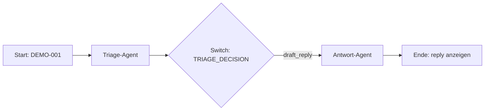
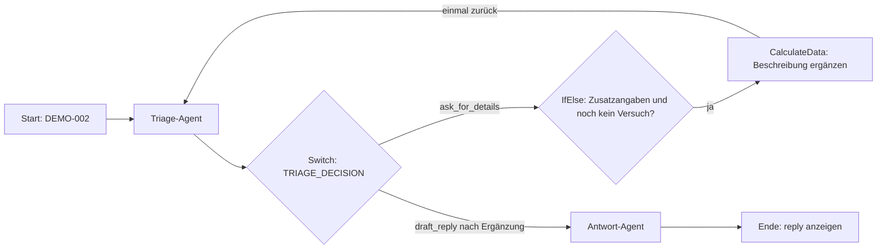
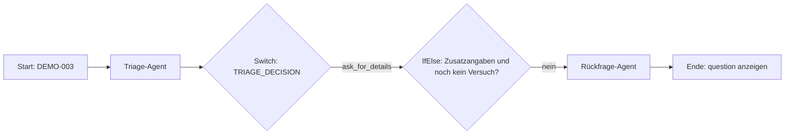

# Beispiel: Support-Ticket prüfen

Auf **AI Workflows → Demo starten** stehen drei Beispieltickets zur Auswahl. Die Eingaben unten entsprechen der Demo; die JSON-Antworten sind mögliche Antworten des konfigurierten Modells, keine aufgezeichneten Läufe.

Der `StartStep` gibt das Ticket unverändert weiter. Der Triage-Agent erhält im Prompt die Ticket-ID und `DESCRIPTION`. Das Mapping übernimmt `$.decision` nach `TRIAGE_DECISION` und `$.message` nach `TRIAGE_MESSAGE`. `category` und `priority` gehören zur JSON-Antwort, werden in dieser Demo aber nicht weitergereicht.

## 1. Beschreibung vorhanden



**Eingabe**

```json
{
  "TICKET_ID": "DEMO-001",
  "DESCRIPTION": "In der Listenansicht der Demo-Tabelle fehlt seit heute die Schaltfläche für den CSV-Export.",
  "DETAILS": "",
  "RETRIED": "no"
}
```

**Triage-Agent:** Erkennt die betroffene Ansicht und das Problem.

```json
{
  "category": "usage",
  "priority": "normal",
  "decision": "draft_reply",
  "message": "Die CSV-Export-Schaltfläche fehlt in der Listenansicht der Demo-Tabelle."
}
```

**Switch und Antwort-Agent:** Der Switch liest `draft_reply`. Der Antwort-Agent bekommt die Ticket-ID, die Beschreibung und `TRIAGE_MESSAGE`.

```json
{
  "reply": "Danke für den Hinweis. Bitte prüfe, ob die CSV-Export-Schaltfläche in derselben Listenansicht auch bei einem zweiten Konto fehlt.",
  "next_step": "Sichtbarkeit der Schaltfläche mit einem zweiten Konto prüfen."
}
```

**Ende:** Der Button zeigt `reply`. `next_step` bleibt Teil der strukturierten Antwort.

## 2. Beschreibung aus Zusatzangaben ergänzen



**Eingabe**

```json
{
  "TICKET_ID": "DEMO-002",
  "DESCRIPTION": "",
  "DETAILS": "CSV-Export fehlt in der Listenansicht.",
  "RETRIED": "no"
}
```

**Erster Triage-Aufruf:** `DESCRIPTION` ist leer. `DETAILS` geht noch nicht an den Agenten.

```json
{
  "category": "other",
  "priority": "normal",
  "decision": "ask_for_details",
  "message": "Die betroffene Ansicht und das beobachtete Problem fehlen."
}
```

**Switch → IfElse → Action:** Bei `ask_for_details` prüft `IfElseStep`, ob `RETRIED` auf `no` steht und `DETAILS` nicht leer ist. Die Aktion `CalculateData` kopiert `DETAILS` nach `DESCRIPTION`, setzt `RETRIED` auf `yes` und gibt das geänderte Ticket an den Triage-Agenten zurück:

```json
{
  "DESCRIPTION": "CSV-Export fehlt in der Listenansicht.",
  "RETRIED": "yes"
}
```

**Zweiter Triage-Aufruf:** Liest die ergänzte Beschreibung. Das Mapping ersetzt die erste Entscheidung und Nachricht.

```json
{
  "category": "usage",
  "priority": "normal",
  "decision": "draft_reply",
  "message": "In der Listenansicht fehlt der CSV-Export."
}
```

**Antwort-Agent:** Erhält Ticket-ID, ergänzte Beschreibung und neue Triage-Nachricht.

```json
{
  "reply": "Danke für die Ergänzung. Bitte nenne den Namen der Liste, in der der CSV-Export fehlt.",
  "next_step": "Namen der betroffenen Liste erfragen."
}
```

**Ende:** Zeigt `reply`. Wenn der Triage-Agent beim zweiten Aufruf erneut `ask_for_details` liefert, geht es zum Rückfrage-Agenten. `RETRIED = yes` verhindert einen weiteren Rücksprung.

## 3. Keine Zusatzangaben vorhanden



**Eingabe**

```json
{
  "TICKET_ID": "DEMO-003",
  "DESCRIPTION": "",
  "DETAILS": "",
  "RETRIED": "no"
}
```

**Triage-Agent:** Erhält die Ticket-ID und die leere Beschreibung.

```json
{
  "category": "other",
  "priority": "normal",
  "decision": "ask_for_details",
  "message": "Die Beschreibung fehlt. Es ist nicht erkennbar, welche Funktion betroffen ist oder was passiert."
}
```

**Switch → IfElse → Rückfrage-Agent:** Der Switch leitet zu `IfElseStep` weiter. Da `DETAILS` leer ist, gibt es keinen Rücksprung. Der Rückfrage-Agent erhält die Ticket-ID, die leere Beschreibung und `TRIAGE_MESSAGE`.

```json
{
  "question": "Welche Funktion ist betroffen und was passiert, wenn du sie verwendest?"
}
```

**Ende:** Zeigt `question`. Der Antwort-Agent wird nicht aufgerufen.
